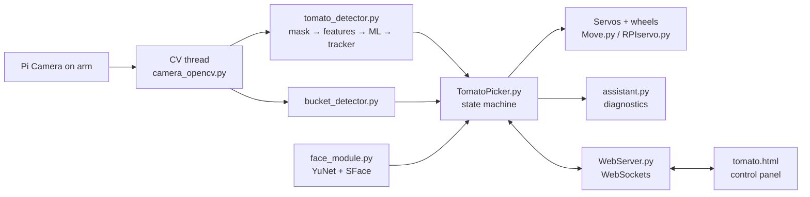

# 🍅 Tomato-Picking Robot: autonomous cherry-tomato harvester

Software for a Raspberry Pi robot that **finds ripe cherry tomatoes with computer vision, picks them with its arm, and drops them into a bucket**. It also recognizes people by name, and it includes a rule-based "AI assistant" that diagnoses problems while the robot runs.

Built for my **Master's thesis** (Academy of Vocational Studies Western Serbia, Užice department, IT) on top of the [Adeept PiCar-Pro](https://github.com/adeept/Adeept_PiCar-Pro) robot kit.


---

## What it does

| Feature | How |
|---|---|
| **Tomato detection** | HSV colour mask (hue wraps around 0/180), candidate blobs, then **~80 hand-crafted features per candidate** (shape, inner and outer colour, highlights, texture, histograms, gradients) |
| **ML classifier** | Ensemble of logistic regression and 3× MLP (64×32): **160,330 training samples, validation AUC 0.996**. Inference runs in **pure NumPy**, so no ML libraries are needed on the Pi |
| **Tracking** | Multi-frame tracker with hysteresis: a target is confirmed after several good frames and released only after it has been missing for a while. This stops "see / don't see" flicker |
| **Picking state machine** | `SEARCH → CENTER → APPROACH → LOWER → GUIDE → GRAB → FIND_BUCKET → APPROACH_BUCKET → DROP` |
| **Bucket detection** | Green-bucket detector that tolerates **occlusion by the gripper** (the camera sits on the arm, so the claw always covers the bottom of the frame) |
| **Face recognition** | YuNet detector (falls back to a Haar cascade), 5-point alignment, then SFace 128-d embeddings with cosine similarity, a threshold and a margin. The robot writes the person's name and waves |
| **AI assistant** | Expert system that reads live telemetry (camera, detection stats, grab success, lighting, calibration) and suggests fixes, each with a one-click **"Apply"** button |
| **Web control panel** | `tomato.html`: auto and manual modes, calibration, live status. Commands go over WebSockets |
| **Safety** | Wheels stop when the target is lost or a frame arrives late, STOP aborts any phase at once, every phase has a timeout, and the ultrasonic sensor acts as an extra brake |
| **One-command recovery** | `install_robot.sh` rebuilds the whole robot on a fresh Raspberry Pi OS: I2C/SPI, packages, faces, autostart and the Wi-Fi hotspot |

## Architecture



Only **one thread ever moves the motors**. The CV thread just *publishes* detections, and the picker thread acts on them. This removes the race conditions between threads.

## Repository layout

```
Server/
  TomatoPicker.py          main picking logic and state machine (~1,800 lines)
  tomato_detector.py       detection, features, ML inference, tracker (hardware-independent)
  tomato_classifier.py     earlier lightweight classifier (logistic regression)
  tomato_model.json        trained ensemble weights
  bucket_detector.py       occlusion-aware bucket detection
  face_module.py           face detection, alignment and recognition
  rebuild_faces.py         rebuilds the face database from saved samples
  assistant.py             rule-based diagnostic assistant
  tomato_config.py/.json   all tunable parameters, persisted
  tomato_datalog.py        telemetry logging
  test_tomato_detector.py  run the detector on images on a normal PC
  dist/tomato.html         web control panel
  WebServer.py, camera_opencv.py, Move.py, RPIservo.py, OLED.py
                           Adeept files, modified (see NOTICE.md)
install_robot.sh           full system restore script
```

## Running it

1. Clone the original kit software: `git clone https://github.com/adeept/Adeept_PiCar-Pro`
2. Copy this repo's `Server/` and `install_robot.sh` over it.
3. Download the face models into `Server/models/`:
   - `face_detection_yunet_2023mar.onnx` and `face_recognition_sface_2021dec.onnx` from [OpenCV Zoo](https://github.com/opencv/opencv_zoo)
   - `haarcascade_frontalface_default.xml` from [OpenCV](https://github.com/opencv/opencv/tree/4.x/data/haarcascades)
4. On the Pi, run `sudo bash install_robot.sh`.
5. Open the robot's IP in a browser, then go to `tomato.html`.

To test detection **without the robot**, run `python3 Server/test_tomato_detector.py <image>`.

> Face samples (`Server/faces/`) are personal data and are deliberately **not** in this repository.
> `WebServer.py` keeps Adeept's default login; change it before using the robot on a shared network.

## Credits

Base hardware and control software: **[Adeept PiCar-Pro](https://github.com/adeept/Adeept_PiCar-Pro)**. Face models: **[OpenCV Zoo](https://github.com/opencv/opencv_zoo)** (YuNet, SFace). Everything for tomato picking, the bucket, faces, the assistant, the web panel and the install script is my own work. Details are in [NOTICE.md](NOTICE.md).

---

### 🇷🇸 Ukratko

Robot za **autonomno branje čeri paradajza**, urađen za master rad. Sistem radi na Raspberry Pi-ju i nadograđuje Adeept PiCar-Pro. Paradajz prepoznaje računarskim vidom uz sopstveni ML model (AUC 0,996), bere ga hvataljkom i ubacuje u kanticu. Robot prepoznaje i osobe po imenu, a ugrađeni asistent dijagnostikuje rad u realnom vremenu. Svim upravlja web panel preko WebSocket-a.

**Autor:** Adnan Malagić · [LinkedIn](https://www.linkedin.com/in/adnan-malagic)
